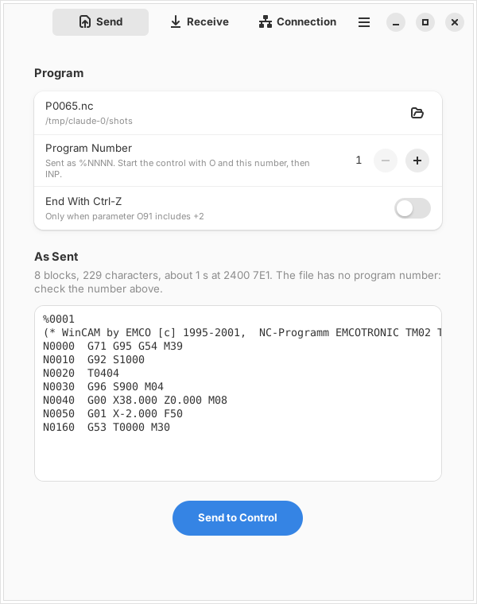
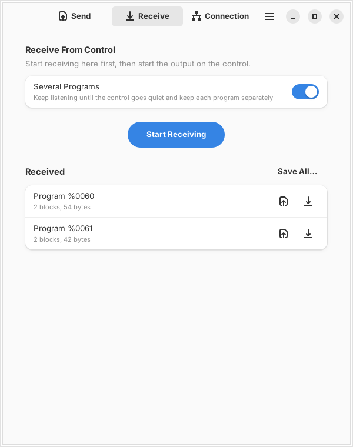
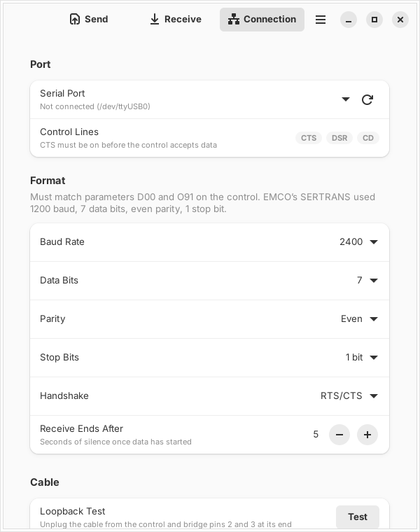
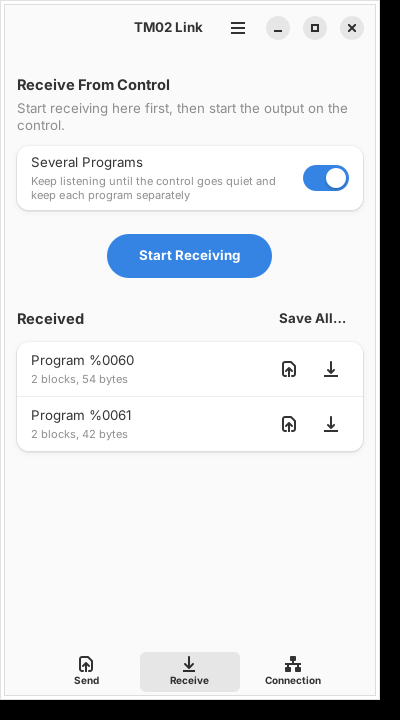

# TM02 Link

A small GNOME app (Rust, GTK 4, libadwaita, Blueprint) for moving NC programs between a PC and an EMCO lathe with an
**EMCOTRONIC TM02** control over RS232. It replaces EMCO SERTRANS and does what `tools/tm02send.py` does, with a UI.

| Send | Receive | Connection | Narrow |
|---|---|---|---|
|  |  |  |  |

- **Send**: open a WinCAM export or a received program; the app writes the `%NNNN ` start line the TM02 needs
  (number from the file or set by you), shows the exact bytes, asks before sending, then shows progress and can stop.
  On the control: `O <number> INP` first.
- **Receive**: start here, then start the output on the control. One program (ends at `M30`) or several (ends at
  Ctrl-Z or after a few seconds of silence; each `%NNNN` program kept separately). The control's NUL/space padding is
  removed; garbled characters are reported as a baud/parity mismatch. Save one, Save All to a folder, or open a
  received program in Send.
- **Connection**: port (USB adapters by name), baud rate, data bits, parity, stop bits (must match D00 and O91),
  handshake (RTS/CTS, XON/XOFF, none), live CTS/DSR/CD while the page is open, and a loopback test (bridge pins 2-3).

Port handling follows the SERTRANS disassembly: DTR held low, RTS high, CTS gates sending, bytes sent verbatim.
Defaults: 2400 baud, 7 data bits, even parity, 1 stop bit, RTS/CTS (O91=121). SERTRANS's own TM02 profile used
1200 baud.

## Build and run

Needs Rust, GTK ≥ 4.14, libadwaita ≥ 1.5 and blueprint-compiler.

```
sudo apt install libgtk-4-dev libadwaita-1-dev blueprint-compiler   # Ubuntu 24.04+
cargo run --release                     # or: cargo run --release -- program.nc
make install                            # into ~/.local, with desktop file and icon
make flatpak                            # GNOME 51 runtime, --device=all for the serial port
cargo test                              # core tests, including send/receive over a pty pair
```

If `blueprint-compiler` is not on PATH or needs a specific Python, set
`BLUEPRINT_COMPILER="python3.12 /usr/bin/blueprint-compiler"`. Outside Flatpak your user must be in `dialout`.

## Layout

- `src/link.rs`: program preparation, send/receive, port setup, port list; unit and pty tests.
- `src/window.rs`, `src/transfer_dialog.rs`: UI logic. Transfers run in a thread and report over a channel.
- `data/ui/*.blp`: Blueprint UI (window, transfer dialog, shortcuts). `data/style.css`: modem line chips.
- Settings: `~/.config/tm02link/settings.json`.

Status: tested against a simulated control on a pty (send, receive one and several, errors). Not yet tried on the
real TM02.
